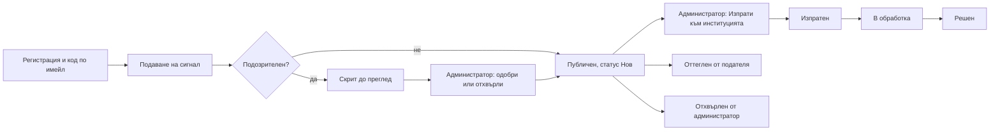

# CallSliven — MVP

> Платформа за подаване и проследяване на граждански сигнали в община Сливен.
> Дипломна работа · Един разработчик · Срок: ≈26 седмици

Този документ определя **какво влиза в MVP**, какво е отложено и в какъв ред се изгражда. Подробните правила стоят в „Решения“ (блокове 1–9). Тук е само обхватът.

## Съдържание

1. [Цел и принципи](#1-цел-и-принципи)
2. [Технологии](#2-технологии)
3. [Основен сценарий](#3-основен-сценарий)
4. [Обхват на MVP](#4-обхват-на-mvp)
5. [Извън MVP](#5-извън-mvp)
6. [Преди реални потребители](#6-преди-реални-потребители)
7. [Статуси, приоритети и срокове](#7-статуси-приоритети-и-срокове)
8. [Каталог на подкатегориите](#8-каталог-на-подкатегориите)
9. [План по седмици](#9-план-по-седмици)
10. [Критерии за приемане](#10-критерии-за-приемане)
11. [Рискове](#11-рискове)
12. [Решения и открити въпроси](#12-решения-и-открити-въпроси)

---

## 1. Цел и принципи

**Цел.** Работещ цялостен цикъл: гражданин се регистрира и подава сигнал → администратор го прегледа и го изпраща към институция → статусът се вижда публично. Сигурността и защитата на личните данни са част от MVP, не се добавят накрая.

**Принципи**

- Вертикални парчета: всяка функция е довършена от базата до интерфейса и е тествана.
- Каталогът (категории, институции, празници) се зарежда със SQL seed, без админ интерфейс за него.
- `real_send` е изключен. Всички писма отиват на демо имейл.
- Всичко, маркирано *Should* или *Could* в „Решения“, е извън MVP, освен ако е изброено в раздел 4.
- Не доказваме, че подателят е човек. Целта е да вдигнем цената на атаката и да ограничим вредата.

## 2. Технологии

| Област | Избор | Бележка |
|---|---|---|
| Фронтенд | Чист HTML, CSS и JavaScript | Без фреймуърк; Vite „vanilla“ по избор за пакетиране |
| База, Auth, Storage | Supabase (PostgreSQL, PostGIS) | Free в началото; **Pro 4–5 седмици преди представянето** |
| Сървърна логика | Supabase Edge Functions (TypeScript) | Ключовете са само тук |
| Планирани задачи | `pg_cron` | Изтриване, срокове, просрочие |
| Хостинг | Firebase Hosting | CSP и заглавките са във `firebase.json` |
| Защита от ботове | Cloudflare Turnstile | Винаги с проверка на сървъра |
| Карта и геокодер | Leaflet + Geoapify | Атрибуция „© OpenStreetMap“ и Geoapify |
| Имейл | Resend (SMTP за Auth, API и webhooks за доставка) | Нужен е собствен домейн |
| Граница на общината | OpenStreetMap, `admin_level=7` | Версионирана в базата |
| AI (последна фаза, по избор) | OpenAI, малък модел | Твърд бюджетен лимит; резерв: правила по ключови думи |
| Тестове | SQL тестове за RLS, Playwright за основния сценарий | |
| Мониторинг | Безплатен пинг през Edge Function към базата | Пази Free проекта от паузиране |

**Две среди:** `development` и `production` (два отделни Supabase проекта). Миграциите са в Git и се прилагат първо в development.

## 3. Основен сценарий

Критерий за успех: този сценарий минава от край до край в Production.

## 4. Обхват на MVP

Означения: **ID** са за проследяване в issues и commits.

### 4.1 Акаунти и защита при вход (AUTH)

- [ ] **AUTH-1** Регистрация: имейл, парола (мин. 12), име, фамилия; телефон по избор
- [ ] **AUTH-2** Съгласие с политиката за поверителност; записват се версията и часът
- [ ] **AUTH-3** Код за потвърждение: 6 цифри, 10 минути, еднократен, хеширан; 5 грешни опита; ново изпращане след 60 секунди, до 3 на час
- [ ] **AUTH-4** Неподтвърден акаунт се изтрива след 24 часа (`pg_cron`)
- [ ] **AUTH-5** Проверка на имейла: формат и MX; нормализиране (малки букви, без +таг) за лимитите
- [ ] **AUTH-6** Вход и възстановяване на парола с еднакво съобщение, което не разкрива дали имейлът съществува
- [ ] **AUTH-7** Turnstile при регистрация, заявка за код и подаване; при вход след 3 грешни опита
- [ ] **AUTH-8** Honeypot поле и минимално време за попълване
- [ ] **AUTH-9** Профил: редакция на име, фамилия, телефон
- [ ] **AUTH-10** Системни имейлове: код при регистрация, възстановяване на парола

### 4.2 Подаване на сигнал (SUB)

- [ ] **SUB-1** Форма на стъпки; въведеното се пази в `sessionStorage`; снимките не се пазят
- [ ] **SUB-2** Категории и подкатегории от базата, с `default_priority` и флаговете „изисква снимка“ и „скрий точния адрес“
- [ ] **SUB-3** Местоположение: адрес, влачене на маркер или GPS с кръг на точността; потвърждението е задължително
- [ ] **SUB-4** Геокодиране през Edge Function с лимит; при недостъпна услуга маркерът се слага на картата
- [ ] **SUB-5** Проверка на сървъра, че точката е в община Сливен (PostGIS, толеранс няколко метра)
- [ ] **SUB-6** Валидация: заглавие 5–100, описание 20–2000 символа; нормализиране на входа
- [ ] **SUB-7** Филтър за лични данни (телефон, имейл, ЕГН, регистрационни номера, връзки); пречистената версия е публична, оригиналът е в `report_private`
- [ ] **SUB-8** Снимки: до 3, до 5 MB, JPG/PNG/WebP; свиване в браузъра; сървърът проверява размер, разширение, MIME и съдържание и премахва EXIF; временна част на частния bucket
- [ ] **SUB-9** Лимит на снимките: 10 на час, по-строг за нови акаунти
- [ ] **SUB-10** Предупреждение за дубликати: радиус 50 м, същата категория, само активни публични сигнали
- [ ] **SUB-11** Задължителна снимка при подкатегории с флаг
- [ ] **SUB-12** Бележка за 112 при подкатегории с най-висок приоритет
- [ ] **SUB-13** Защита от двойно подаване: UUID на отваряне на формата, валиден 24 часа
- [ ] **SUB-14** Ядро в една транзакция: сигнал, `report_private`, история, Audit Log; след това повторяеми стъпки (преместване на снимките)
- [ ] **SUB-15** Лимити: нов акаунт 3 сигнала за 24 часа, после 5 на час и 20 на ден; мек лимит по IP с нова проверка на Turnstile
- [ ] **SUB-16** Автоматично маркиране на подозрителни (виж раздел 7.4); те са скрити до преглед
- [ ] **SUB-17** Публично местоположение: закръгляне до мрежа от ≈15 м, адрес без номер; улица или населено място при флаг „скрий точния адрес“

### 4.3 „Моите сигнали“ (MY)

- [ ] **MY-1** Списък със статуси и бележка „променено от последното ти влизане“
- [ ] **MY-2** Оттегляне, докато няма първо действие от администратор
- [ ] **MY-3** Причина за отхвърляне (и по имейл)
- [ ] **MY-4** Времева линия на основния сигнал при дубликат

### 4.4 Администраторски панел (ADM)

- [ ] **ADM-1** Вход с парола (мин. 15) и TOTP MFA; админските таблици само при ниво `aal2`; сесия 8 часа
- [ ] **ADM-2** Админ акаунтите се създават ръчно (без покани); първите двама Super Admin са ръчни
- [ ] **ADM-3** Списък със сигнали: филтри по статус, приоритет, категория, подозрителни, просрочени; сортиране и по приоритет
- [ ] **ADM-4** Списък „Изискват внимание“: критични, просрочени, непрегледани подозрителни
- [ ] **ADM-5** Детайл на сигнал: точна карта, оригинален текст, снимки (подписани линкове), история
- [ ] **ADM-6** Смяна на статус; смяна на категория, подкатегория, институция и приоритет със записана причина
- [ ] **ADM-7** Отхвърляне с причина от фиксиран списък и по избор бележка; имейл до подателя
- [ ] **ADM-8** Свързване на дубликат („дубликат на №…“); сигналите не се обединяват автоматично
- [ ] **ADM-9** Преглед на подозрителни: одобри, отхвърли, свържи, ограничи акаунта до 7 дни
- [ ] **ADM-10** Правило за институция по подкатегория; опашка „Неопределена институция“
- [ ] **ADM-11** „Изпрати към институцията“: само веднъж; „Изпрати отново“ с причина; ръчно „препратено“ при институции без имейл
- [ ] **ADM-12** Писмото съдържа номер, категория, заглавие, пречистен текст, точно местоположение и снимки с временни линкове
- [ ] **ADM-13** Събития за доставка от Resend webhooks (Доставен / Неуспешна доставка); ръчно повторение
- [ ] **ADM-14** Сроковете по приоритет (раздел 7.2); жълта и червена маркировка
- [ ] **ADM-15** Оптимистично заключване чрез версия на записа
- [ ] **ADM-16** Audit Log само за добавяне (тригер блокира промяна и триене)

### 4.5 Super Admin (SA)

- [ ] **SA-1** Управление на роли и акаунти (деактивиране, не изтриване; последният Super Admin не може да бъде понижен)
- [ ] **SA-2** `real_send` по институция и превключвател „Спри всички изпращания“
- [ ] **SA-3** Достъп до имейл и телефон само през функция със записана причина в Audit Log
- [ ] **SA-4** Категории, институции и празници се управляват през SQL миграции

### 4.6 Публична част (PUB)

- [ ] **PUB-1** Страница „Сигнали“: карта до 500 точки с групиране, списък по 20 (макс. 50), брой намерени
- [ ] **PUB-2** Търсене по триграми; филтри по категория и период
- [ ] **PUB-3** Сортиране: най-нови, най-стари, последно актуализирани
- [ ] **PUB-4** Страница на сигнала: номер, дата, статус, заглавие, пречистено описание, категория, закръглено местоположение, хронология, „още N сигнала“; `noindex`
- [ ] **PUB-5** Не се публикуват: име, телефон, имейл, снимки, приоритет, вътрешни бележки, журнал, причини за отхвърляне, неуспешна доставка
- [ ] **PUB-6** Отхвърлен и оттеглен сигнал дава „Сигналът не е наличен“

### 4.7 Сигурност и надеждност (SEC)

- [ ] **SEC-1** RLS на всички таблици, по подразбиране с забрана; публичен достъп само през изглед с изброени колони
- [ ] **SEC-2** SQL тестове за достъпа за всяка роля (посетител, потребител A и B, администратор, Super Admin)
- [ ] **SEC-3** CSP (без inline скриптове), HSTS, `frame-ancestors none`, `nosniff`, Referrer-Policy, Permissions-Policy
- [ ] **SEC-4** Ключовете само в Edge Functions; `.env` не е в хранилището; библиотеки с фиксирани версии, самохоствани
- [ ] **SEC-5** Показване с `textContent`, без `innerHTML` от потребителски вход
- [ ] **SEC-6** `security_events` и `system_events` (30 дни), без лични данни
- [ ] **SEC-7** Планирани задачи през `pg_cron` със запис в `system_events`; брояч на провалите в админ панела
- [ ] **SEC-8** Пинг през Edge Function към базата (докато проектът е на Free)
- [ ] **SEC-9** Експорт на базата преди всяка миграция в Production; седмичен шифрован експорт
- [ ] **SEC-10** Security Advisor на Supabase без критични находки

## 5. Извън MVP

Отлага се и не се започва, докато MVP не е готов.

- Подаване като гост
- Блокиране на еднократни домейни за имейл (*Should*)
- Покани по имейл за администратори; администраторски интерфейс за категории, институции и празници
- Разпределение на сигнали по администратор; роля „Одитор“
- Филтри по статус, район, подкатегория и институция (*Should*)
- Сходство на описанията и снимките при дубликати
- „Подай отново“ след отхвърляне
- Видео; антивирусно сканиране
- Автоматично изпращане към институция
- Известия със звънче; потребителски настройки за имейл
- „Изтегли моите данни“ (*Should*)
- Зависимост на институцията от мястото; известяване на кметства
- Staging среда; автоматична проверка на Storage; разширен мониторинг
- Изтриване на неактивни акаунти след 24 месеца

## 6. Преди реални потребители

Не е нужно за демонстрация пред комисия, но трябва да е готово преди първия реален потребител:

- [ ] Написана политика за поверителност и условия (администратор на данните, обработващи: Supabase, Cloudflare, Resend, Geoapify, Firebase, OpenAI при ползване; трансфери извън ЕС)
- [ ] Самообслужващо изтриване на профил и спазване на сроковете за съхранение (блок 6)
- [ ] Смяна на имейл с код и известие до стария
- [ ] Supabase Pro: дневни бекъпи, таймаут на сесията, проверка за изтекли пароли; проверено възстановяване
- [ ] Проверени контакти на институциите и решение за `real_send`

## 7. Статуси, приоритети и срокове

### 7.1 Статуси

| Статус | Видим публично | Бележка |
|---|---|---|
| Нов | да | |
| Изпратен | да | Задава се при изпращане към институция |
| В обработка | да | Слага администраторът при потвърждение от институцията |
| Решен | да | Спира срока за решаване |
| Затворен | да, с кратка причина | Институцията отказва, извън компетенция, без отговор |
| Отхвърлен | не | Фиксиран списък с причини |
| Оттеглен | не | От подателя, преди първо действие на администратор |

„Доставен“ и „Неуспешна доставка“ са събития на доставката, не статуси.

### 7.2 Приоритети и срокове

| Ниво | Първа реакция | Срок за решаване | Броене |
|---|---|---|---|
| Критичен | до 1 час | 24 часа | календарни часове |
| Висок | 1 работен ден | 3 дни | работни дни |
| Среден | 3 работни дни | 14 дни | работни дни |
| Нисък | 7 дни | 30 дни | работни дни |

Часовникът тръгва от подаването (за подозрителен: от одобрението) и не се паузира. Жълто = просрочена първа реакция, червено = просрочено решение. Приоритетът не е публичен.

### 7.3 Роли

| Роля | Достъп |
|---|---|
| Посетител | Публичният изглед |
| Потребител | Свой профил и свои сигнали |
| Администратор | Сигналите, вътрешните бележки, име и фамилия. Без имейл и телефон |
| Super Admin | Имейл и телефон само през функция със записана причина; пълен Audit Log |

### 7.4 Правила за маркиране като подозрителен

Сигналът се скрива до преглед, ако е изпълнено поне едно:

- попълнено honeypot поле;
- изпратен по-бързо от минималното време;
- повече от 3 сигнала от един хеш на IP за 10 минути;
- има връзка (URL) в текста;
- текстът е същият като на друг сигнал от акаунта;
- филтърът за лични данни намери 3 или повече.

## 8. Каталог на подкатегориите

Чернова за seed. **Колоната „Категория“ е предложение**, защото в „Решения“ са дефинирани само подкатегориите.

| № | Категория (предложение) | Подкатегория | Приоритет | Основна институция | Копие |
|---|---|---|---|---|---|
| 1 | Пътища | Опасна дупка на улица | Висок | Община, Техническа инфраструктура | |
| 2 | Пътища | Повреден тротоар | Среден | Община, Техническа инфраструктура | |
| 3 | Пътища | Пътна маркировка, знаци, пешеходни пътеки | Среден | Община, Техническа инфраструктура | |
| 4 | Пътища | Неработещ светофар | Висок | Община, Техническа инфраструктура | |
| 5 | Пътища | Републикански път / АМ „Тракия“ | Висок | ОПУ Сливен | |
| 6 | Пътища | Нарушена настилка след разкопаване | Среден | Община, Строителен контрол | |
| 7 | Комунални услуги | Неработещо улично осветление | Среден | Сименс мобилити (ръчно) | |
| 8 | Комунални услуги | Паднал стълб или кабел под напрежение | Критичен | ЕВН | Управление при кризи |
| 9 | Комунални услуги | Спряно електрозахранване | Висок | ЕВН | |
| 10 | Комунални услуги | Авария на водопровод, липса на вода | Висок | ВиК Сливен | |
| 11 | Комунални услуги | Запушена канализация, шахта без капак | Висок | ВиК Сливен | |
| 12 | Комунални услуги | Миризма на газ, изтичане | Критичен | Газтрейд Сливен | Управление при кризи |
| 13 | Комунални услуги | Проблем с топлоснабдяването | Среден | Топлофикация Сливен | |
| 14 | Околна среда | Нередовно сметоизвозване | Среден | Община, Екология | |
| 15 | Околна среда | Нерегламентирано сметище | Среден | Община, Екология | |
| 16 | Околна среда | Екологично замърсяване | Висок | РИОСВ | |
| 17 | Околна среда | Опасно дърво или клон | Висок | Община, Екология | |
| 18 | Околна среда | Повредена детска площадка или пейка | Среден | Община, Екология | |
| 19 | Околна среда | Неподдържана зелена площ | Нисък | Община, Екология | |
| 20 | Животни | Безстопанствени животни | Среден | Община, Екология | |
| 21 | Животни | Нехуманно отношение към животни | Среден | ОДБХ | |
| 22 | Строителство | Незаконно строителство или гараж | Нисък | Община, Строителен контрол | |
| 23 | Строителство | Опасна или самосрутваща се сграда | Висок | Община, Строителен контрол | |
| 24 | Транспорт и ред | Неправилно паркиране, синя зона | Нисък | ОП „Градска мобилност“ | |
| 25 | Транспорт и ред | Спирка или градски транспорт | Нисък | Пътнически превози | |
| 26 | Транспорт и ред | Нарушаване на обществения ред | Висок | ОДМВР | |
| 27 | Безопасност | Пожар или опасност от пожар | Критичен | РДПБЗН | Управление при кризи |
| 28 | Безопасност | Авария или бедствие | Критичен | Управление при кризи | |
| 29 | Здраве и хигиена | Дезинсекция, дератизация | Среден | Община, Социални дейности | |
| 30 | Здраве и хигиена | Хигиена, заразни болести, тютюнопушене | Среден | РЗИ | |
| 31 | Здраве и хигиена | Безопасност на храните | Среден | ОДБХ | |
| 32 | Друго | Друго | Нисък | Неопределена институция | |

## 9. План по седмици

| Седмици | Фаза | Резултат |
|---|---|---|
| 1–2 | **Sprint 0** | Избор на технологии, Git, два Supabase проекта, CI, ER модел и SQL схема, RLS основа, wireframes, seed на категории и институции |
| 3–6 | **Акаунти** | AUTH-1…10, Turnstile, лимити, собствен SMTP |
| 7–11 | **Подаване** | SUB-1…17, MY-1…4 |
| 12–16 | **Админ панел** | ADM-1…16, SA-1…4 |
| 17–19 | **Публична част** | PUB-1…6. **MVP е цялостен към седмица 19** |
| 20–22 | **Готовност** | Раздел 6, SEC-1…10, **преход към Supabase Pro**, тест на възстановяването, Playwright сценарий |
| 23–26 | **Буфер** | AI препоръка (ако остане време), поправки, документация, подготовка за защита |

Ако някоя фаза закъснее, първо падат AI препоръката и подобренията.

## 10. Критерии за приемане

- [ ] Сценарият от раздел 3 минава от край до край в Production.
- [ ] SQL тестовете за всички роли минават: потребител B не вижда сигнал на A, посетителят не чете `report_private`.
- [ ] Точка извън общината, 4-та снимка, файл с фалшиво разширение, двойно натискане и надхвърлен лимит са отхвърлени правилно.
- [ ] Подозрителен сигнал е скрит публично, а администраторът вижда причината.
- [ ] Администратор без MFA не достига админските таблици.
- [ ] Audit Log не може да се променя или трие.
- [ ] Публичният изглед и страницата на сигнала не съдържат снимки, приоритет, контакти и точни координати.
- [ ] Security Advisor няма критични находки.
- [ ] Възстановяване от бекъп е тествано поне веднъж.

## 11. Рискове

| Риск | Мярка |
|---|---|
| Един разработчик, голям обхват | Вертикални парчета, буфер от 4 седмици, ясен списък „Извън MVP“ |
| Доставяемост на имейлите | Собствен домейн, SPF/DKIM/DMARC, ранен тест (седмица 3) |
| Условия на геокодера | Тест на 15–20 адреса (вкл. села) и писмено потвърждение за запазване на резултатите |
| Паузиране на Free проекта | Пинг през Edge Function; ранен преход към Pro |
| Правна неяснота (лични данни, препращане към институции) | Политика за поверителност и консултация преди реални потребители |
| Разрастване на обхвата | Нови идеи отиват в раздел 5 |

## 12. Решения и открити въпроси

### Взети решения

- Чист HTML, CSS и JavaScript без фреймуърк
- Supabase Free → Pro 4–5 седмици преди представянето
- Geoapify за геокодер и плочки; MapTiler Free като резервен вариант за плочки (нетърговска употреба)
- Resend за имейл; безплатен `.me` домейн от GitHub Student Pack
- OSM полигон на общината (`admin_level=7`)
- `real_send` е изключен

### Открити

- [ ] Дали Geoapify позволява запазване на резултатите (писмено)
- [ ] Тест на геокодера на 15–20 реални адреса
- [ ] Конкретен домейн
- [ ] Лимит на снимките за нов акаунт (предложение: 9 за първите 24 часа и най-много 5 на час)
- [ ] Отделна таблица `report_events` за публичната история (Audit Log се пази 12 месеца, а хронологията е трайна)
- [ ] GPT модел и бюджетен лимит (не блокира преди седмица 23)
- [ ] Данни за филтъра „район“ (извън MVP)
- [ ] Проверени контакти на институциите (преди реални потребители)
